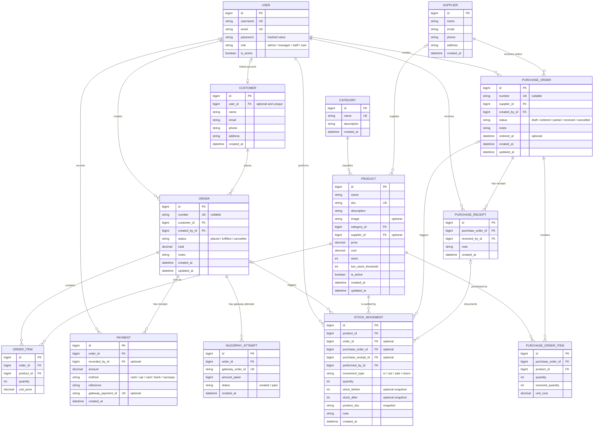

# Orevon - Entity-Relationship Diagram

This diagram documents the Django ORM models in `backend/accounts/models.py` and `backend/inventory/models.py` as reviewed on November 15, 2026. It covers the shared database used by the Orevon web application and Android APK.

## Relationships and business rules

- **Users and roles:** The custom Django `accounts.User` model supports Admin, Manager, Staff, and User roles. Staff/admin accounts can be associated with created orders, stock movements, purchase orders, and purchase receipts.
- **Customer accounts:** A customer record can exist without a login. Its optional `user` relationship is one-to-one, and model validation requires a linked account to have the `user` role.
- **Product catalog:** Each product belongs to a category and may optionally have a supplier. SKU and category name are unique. Products can be archived using `is_active`.
- **Sales:** A sales order belongs to a customer and an account that created it. An order can have multiple order items, payments, gateway attempts, and linked inventory movements. Each `(order, product)` pair is unique among order items.
- **Purchasing:** A purchase order belongs to a supplier and a creator. It has line items and may have several receiving events. Each `(purchase_order, product)` pair is unique among purchase order items. Item-level database checks enforce ordered quantity >= 1 and received quantity <= ordered quantity.
- **Inventory audit:** Stock movements reference a product and the user performing the movement. They can optionally reference a sales order, purchase order, or purchase receipt. Stock balance snapshots and the SKU snapshot are retained when available.
- **Payments:** Payment records belong to a sales order and optionally identify the recording user. `gateway_payment_id` is unique when supplied. Razorpay gateway attempts are tracked separately from confirmed payments.
- **Validation:** Prices, costs, amounts, and quantities have model validators and positive-integer field types where defined. Do not assume every model validator is also a database-level `CHECK` constraint.

## Database environments

- **Local development:** SQLite is available when `DATABASE_URL` is not set.
- **Hosted deployment:** PostgreSQL on Render is used by the deployed Django API; the React web and Expo Android apps access it through that same API.

The diagram represents declared Django model relationships; it does not by itself establish that every workflow or permission has been integration-tested.
