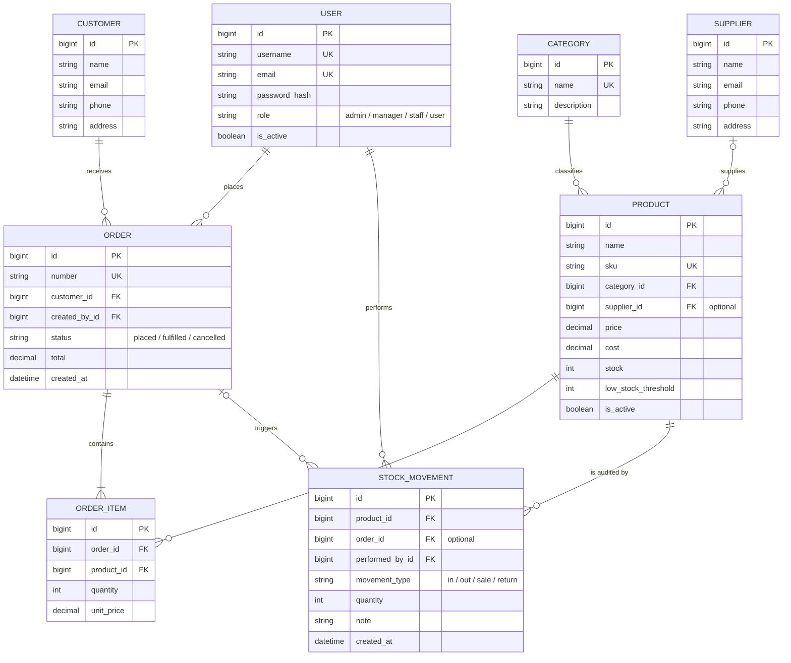

# SmartStock Entity–Relationship Diagram

## Invariants and constraints

- `Product.sku` and `Category.name` unique.
- One `(order_id, product_id)` pair per order item (unique constraint).
- Product prices and costs nonnegative; quantities positive and stock nonnegative.
- `Category` and historical product/order references use restrictive deletes so business history cannot be accidentally erased.
- Product archive uses `is_active=false`, preserving historical order items.
- Stock changes are recorded by a linked audit movement inside the same transaction.
- Order creation locks product rows in ID order and atomically deducts inventory; a cancellation atomically restores inventory only once.
- Roles are stored in a custom Django `accounts.User` model.

**Development:** SQLite. **Production:** PostgreSQL recommended; migrations create indexes, foreign keys and integrity constraints.
